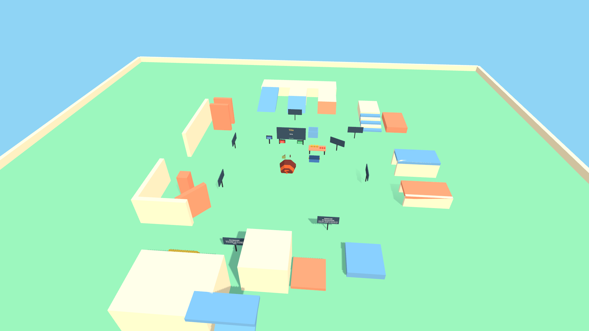
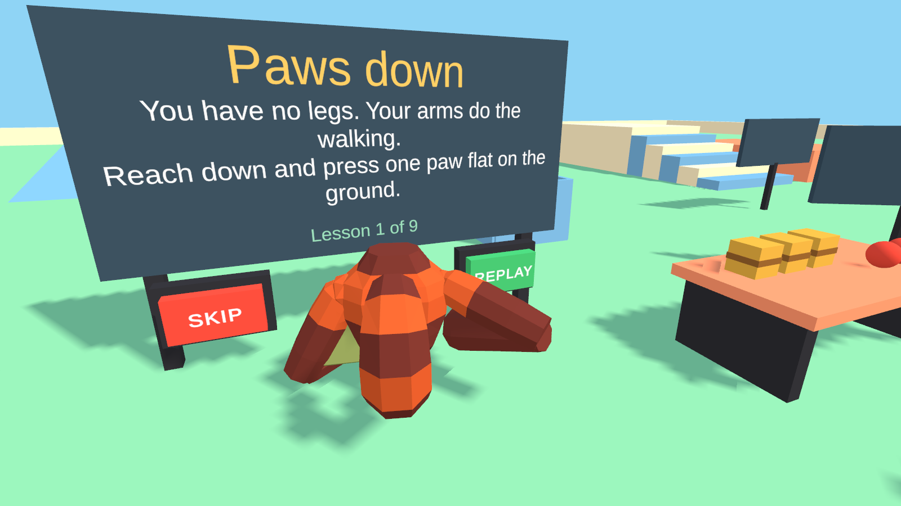
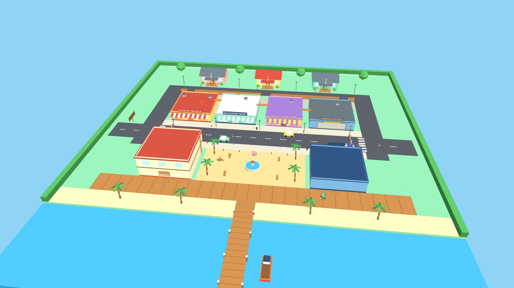
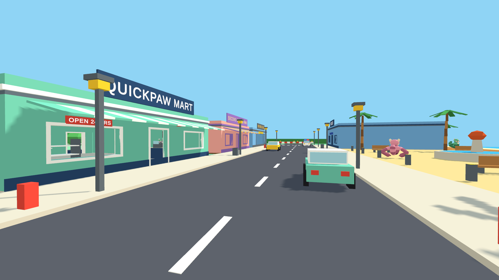
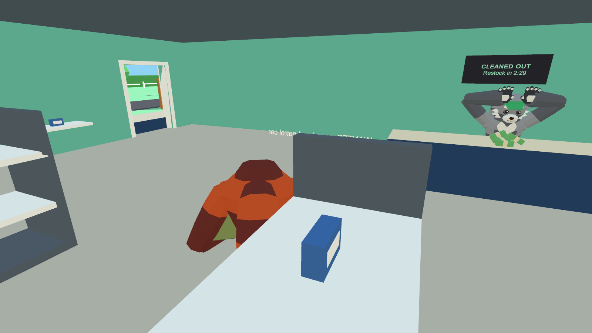
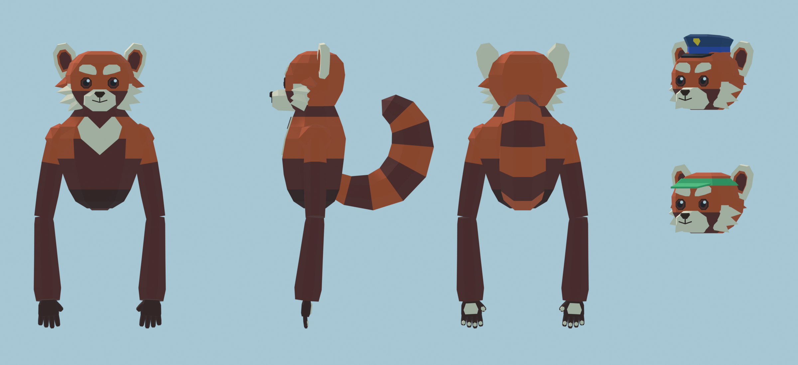

# Status

Last updated: 2026-11-13.

"Verified" below always says **how**. Three levels are used and they are not interchangeable:

- **Automated**: a headless test drives the real solver against real colliders with scripted
  controller motion, or loads the real scene and plays it through the keyboard simulator.
- **Build**: the project compiles and produces an Android APK.
- **Headset**: a person tested it wearing a Quest. **Nothing has been headset-tested yet.** No
  headset was connected to the development machine and `adb` is not on its PATH.

## Milestones

| Milestone | State |
|---|---|
| A. XR foundation and movement | Implemented. Automated and build verified. Headset testing outstanding |
| B. Complete solo gameplay loop | Implemented. Automated and build verified. Headset testing outstanding |
| C. Cooperative play | Implemented for local network play. Verified with 2 and 4 real connected processes. Headset testing and internet sessions outstanding |
| D. Town progression | Not started. The rig already supports seats (see below) |
| E. Expansion and polish | Not started |

## Milestone A feature status

| Feature | Implemented | Verified by |
|---|---|---|
| Contact-based hand propulsion (drag a planted hand, body moves the other way) | Yes | Automated |
| Hands in empty air never propel | Yes | Automated |
| Alternating pushes run | Yes | Automated (about 2.2 m/s with the scripted stride) |
| Downward push jumps, then lands | Yes | Automated |
| Wall push-off; ordinary walls are slippery | Yes | Automated |
| Grip-to-climb on yellow striped surfaces, pull up, fling on release | Yes | Automated |
| Release keeps controlled momentum; launch speed clamped; momentum decays on the ground | Yes | Automated |
| Virtual hands separate from controllers, never pass through walls | Yes | Automated |
| Body never passes through walls, including physically walking into one | Yes | Automated |
| Inside corners | Yes | Automated |
| Gentle slopes hold, steep slopes shed the player | Yes | Automated |
| Stairs climbed by striding | Yes | Automated |
| Low ceilings: real-life crouch shortens the body | Yes | Automated |
| Arm reach limit | Yes | Covered indirectly; no dedicated test |
| Moving platforms carry the player without launching them | Yes | Automated |
| Hand tracking loss, controller pose glitch, recentre: no launch | Yes | Automated |
| Consistent at 45, 72 and 120 Hz | Yes | Automated (within 12 to 15 percent travel distance) |
| Snap turn, pivoting on the head, once per flick, safe with a planted hand | Yes | Automated |
| Height and reach calibration, saved per device | Yes | Automated (maths). Persistence not tested |
| Unstuck (hold A + X) to the last safe ground | Yes | Automated |
| Fall out of world respawns | Yes | Automated |
| Seat mode: rig follows a seat, propulsion off, no launch on exit, horizon stays level | Yes | Automated. No vehicle exists yet |
| Grab, release, throw with hand velocity | Yes | Automated |
| A carrying hand does not propel; the free hand does | Yes | Automated |
| Items are never locomotion surfaces | Yes | Automated |
| Hand-to-hand swap | Yes | Automated |
| Heavy items: one hand cannot lift, two can | Yes | Automated |
| Hip bag: store, take, capacity, reject bulky items, feedback | Yes | Automated |
| A disabled grabber releases its item (groundwork for disconnects) | Yes | Automated |
| Tutorial: nine steps, skippable, replayable, resumes after interruption | Yes | Automated for start, first step, skip, replay. Later steps and resume-after-restart not tested |
| Simulated keyboard and mouse input | Yes | Automated for W, Space, E in the real scene. Other keys untested |
| Movement test scene (walls, corners, ramps, steps, low ceilings, moving platforms, climb wall, carry table) | Yes | Automated load and play; pictures in this folder |
| Red panda torso, arms, paws, satchel | Yes | Picture only |
| Haptics and procedural sounds | Yes | Sound triggers counted in tests. Haptics need a headset |
| OpenXR for Quest (loader, Meta Quest Support, Touch and Touch Plus profiles) | Configured | Settings assets inspected; OpenXR libraries present in the APK |
| Android development build | Yes | Build |

Test totals from the last run: see `Logs/editmode-results.xml` and `Logs/playmode-results.xml`
(all passing at the time of writing). Rerun with `./run_checks.sh tests`. Co-op is additionally
checked by `python3 Tools/coop_check.py --players 2` and `--players 4`.

## Milestone B feature status

| Feature | Implemented | Verified by |
|---|---|---|
| Coastal town built in Blender: pizza place, convenience store, pawn shop, garage, apartments, police station, plaza, boardwalk and pier, alley, rooftop route, three houses | Yes | Renders from Blender and Unity; model-to-layout alignment check on every build |
| Red panda player model built in Blender (head, torso with tail, arms, paws, police cap, visor) | Yes | Renders; part bounds checked in Unity against the authored values |
| Townsfolk and police as recoloured pandas | Yes | Renders |
| Wallet with idempotent transactions; bank; purchases; fines | Yes | Automated |
| Versioned save file with backup; corrupt, missing, older and newer files handled | Yes | Automated |
| Restart restores money and purchases, not wanted level; old payouts cannot be replayed | Yes | Automated |
| All prices, payouts, timers and police numbers in one data asset | Yes | Automated (spot checks) |
| Job framework: accept, objective, pay once, cancel, one job at a time | Yes | Automated |
| Pizza delivery: toppings, oven, boxing, delivery, speed tip, lost pizza replaced, cancel cleans up, repeatable | Yes | Automated, including a run through the real Town scene |
| Robbery rules: fixed register contents, alarm, cooldown, restock, no farming | Yes | Automated |
| Hold-up starts by aiming the pistol at the cashier, or firing inside | Yes | Automated for aiming. Firing-inside path not tested |
| Physical cash bundles; shelves of goods; shoplifting detection (even inside the satchel) | Yes | Automated |
| Pistol: trigger, ammunition, auto reload, hits what it points at, never hits other players | Yes | Automated |
| Witnesses report only what they could see; reports are delayed | Yes | Automated |
| Wanted level per player: reports raise it, staying unseen clears it, long level 2 chases escalate | Yes | Automated |
| Police sight: range, view cone, obstruction; not through walls | Yes | Automated |
| Police states: patrol, investigate, pursue, search, give up, arrest, stunned | Yes | Automated for investigate, search, give up, pursue and arrest. Patrol loop and stun not tested |
| Level 2 squad and patrol car | Yes | Automated in the Town scene |
| Level 3 five officers and roadblock | Yes | Not tested |
| Rooftop suspects: officers go to the nearest reachable point and watch | Yes | Sight over a wall is tested. An actual rooftop chase is not |
| Arrest: fade, fine from wallet only, carried stolen goods confiscated, release at the station, purchases kept | Yes | Automated (the fade itself is not asserted) |
| Stolen cash becomes money only after escaping | Yes | Automated |
| Pawn shop: each item sells once | Yes | Automated |
| Purchases: pistol and bigger satchel; pistol appears in the world, returns home if lost | Yes | Automated for buying and for the satchel upgrade. Lost-pistol return not tested |
| Wrist device (money, wanted pips, objective, bag, save status); toast messages | Yes | Compiles and runs in the Town scene. Readability and placement need a headset |
| Falling in the sea returns you to the dock | Yes | Not tested |
| Town to gym and back | Yes | The gym's TOWN button was triggered in a test run (by accident, which is why it moved) |

Not built in Milestone B, by design or deferral: an ATM for the bank (the logic exists), a map,
inventory and settings screens on the wrist device, interiors for the garage upstairs and
houses, and any second job or robbery type (Milestone D).

## Milestone C feature status

"Multi-process" below means `Tools/coop_check.py`: separate copies of the desktop build, each a
real network peer over UDP on localhost, driven by a scripted bot, with their reports compared.
It proves replication and authority. It does not prove anything about real headsets, real Wi-Fi,
latency or packet loss: localhost has none.

| Feature | Implemented | Verified by |
|---|---|---|
| Menu: solo, host, join by typed address; solo is a private session of one | Yes | Multi-process for host and join. Typing on the keypad not tested |
| 1 to 4 players; a fifth is refused; solo refuses everyone | Yes | 2 and 4 players multi-process. Refusals not tested |
| Head and hands of every player shown to the others, smoothed remotely, never locally | Yes | Players see each other (count). Visual quality not checked |
| Different fur colour per player | Yes | Not checked |
| Shared items: one holder, host arbitrates grabs, holder simulates | Yes | Multi-process: 3-way contested grab has exactly one winner |
| Item position follows its holder on every machine | Yes | Multi-process (probe run; delivery depends on it) |
| Passing an item between players (host makes pizza, client carries it) | Yes | Multi-process |
| Satchel contents hidden from others, tracked by the host | Yes | Multi-process (bagged cash is banked or confiscated correctly) |
| Disconnect while holding an item releases it; nothing stays grabbed | Yes | Multi-process |
| Job state shared; any player can do any step; everyone is paid once | Yes | Multi-process with 4 players and automated rule test |
| Toppings validated by the host (must actually be at the pizza) | Yes | Multi-process for the accepted case. Rejection not tested |
| Robbery shared: same register sign, same cash bundles on every machine | Yes | Multi-process |
| Pistol: shooter sees it at once, host decides the hit, others see it | Yes | Aim-triggered hold-up by a client is multi-process verified. Shot effects on other machines not checked |
| Wanted level per player; bystanders stay clean; taking the cash makes you an accomplice | Yes | Multi-process and automated rule tests |
| Police and NPCs run on the host, appear in the same place for everyone | Yes | Multi-process (same officer count; position compared in the probe run) |
| Each player escapes on their own clock; only the wanted are chased or arrested | Yes | Automated rule tests; multi-process for one escape and one arrest |
| Arrest happens to one player only: their fine, their stolen goods, their fade | Yes | Multi-process and automated rule test |
| Purchases and payouts decided on the host and mirrored to the player's own save | Yes | Multi-process for amounts. Writing the save file on a client not tested (bots run with saving off) |
| Stolen cash cannot be pocketed in the seconds before the alarm | Yes | Multi-process (found by it, in fact) |
| Host leaves: clients return to the menu with an explanation | Yes | Multi-process |
| Host's sanity check on player movement (rejects impossible jumps, allows announced teleports) | Yes | Automated for the rule. Never triggered in a real session |
| Host can cancel a stuck job (`NetSession.HostResetJob`) | Yes | Not tested, and there is no button for it yet |
| Internet play via Unity Multiplayer Services sessions | No | See below |

**Not done in Milestone C**

- **Internet sessions.** `com.unity.services.multiplayer` is not installed. It needs this
  project linked to a Unity Cloud project (Edit > Project Settings > Services), which is an
  account step I cannot do. Until then play is local network only, by typed address.
- **Two players lifting one heavy object.** Heavy items exist only in the gym, which is
  single-player. The force-per-hand design supports it; the networking for a shared lift is not written.
- **Late joining mid-robbery or mid-job** should work (state is replicated) but is untested.
- **Vehicles and passengers** are Milestone D.

## Not verified, needs a headset

1. Whether the movement **feels** right. Every tuning value is a first guess based on the
   physics, not on play. Expect to tune propulsion, jump strength, friction and body length.
2. Paw orientation and offset relative to the Touch grip pose.
3. Default body length (0.78 m, eyes to ground) against real arm length. Calibration exists for
   this (hold B + Y).
4. Haptics through the OpenXR plug-in.
5. That the APK launches into VR on Quest 3 / 3S. It builds; it has not been installed.
6. Frame rate. **Target: 72 FPS on Quest 3 / 3S. Measured: nothing yet.**
7. Tracked pose latency of the virtual hands (they get a late pose update before render, except
   while planted).
8. Everything in Milestone B as it feels in the hand: pressing toppings onto a pizza, holding
   and aiming the pistol (its grip pose is a guess), reading the wrist device, and whether the
   police are too fast or too slow for real arm-running.
9. Town scale. It is built for 0.8 m eyes on paper; doorways, counters and shelves need a look
   from inside the headset.
10. Co-op between real headsets: joining over Wi-Fi, how remote players look and move with real
    latency, whether waiting for the host's answer makes grabbing feel sluggish, and frame rate
    with four players.

## Known issues and limits

- Slapping the ground hard makes the body hop, because a fast push is a real push. Plant gently
  to walk. If this is annoying in the headset, lower `propulsionMultiplier` or raise
  `minLaunchSpeed`.
- Climbing a flat ordinary wall is impossible by design: push-only hands push you away from it.
  Use ledges, two facing walls, or yellow climbable surfaces.
- The simulated stride is bouncy on stairs. It is a test aid, not a tuned animation.
- Snap turn has no in-game toggle yet (`PlayerRig.snapTurnEnabled`). Smooth turn is not implemented.
- There is no wrist menu or settings UI. Calibration and unstuck are button holds only.
- Headless screenshots must refresh the SRP batcher before rendering, or every material shows
  one colour. This affects only the capture helpers, which already do it. Worth a glance on
  first headset run all the same.
- PC VR: OpenXR is enabled for Android only. The setup script enables the desktop loader
  automatically when run on a Windows editor.
- No licence file has been added to the repository yet.
- Netcode's own NetworkTransform did not deliver client-held item positions to the host in this
  setup, so shared objects use a small pose component of ours (`NetPose`). Cause not identified.
- A client's grab waits for the host's answer (one round trip). Instant on a good local
  network; could feel late on a bad one. There is no client-side prediction of grabs.
- Host migration is not supported: if the host leaves, the game ends for everyone.
- The Town end-to-end test once read a wanted level of 0 straight after a robbery during a full
  test run, and passed when rerun. The cause was not pinned down (an early arrest by a nearby
  officer is the likely one). The test now records peak values over the window instead of the
  final instant, and has passed in every run since.
- The join keypad accepts any text; a wrong address just times out after a few seconds.
- NPCs and remote players are not solid: you can move through them.
- NPCs and police do not physically block the player or each other; an arrest is by proximity.
- The patrol car drives on a rail along the main street. It does not path-find.
- Police speed is tuned against the simulated stride (about 2.2 m/s). Real players may be much
  faster or slower. `officerChaseSpeed` in the balance asset is the dial.
- The player's own tail is large in third-person captures and may show at the edge of view
  when looking down and back.
- Hats sit slightly inside the head mesh at the sides.
- Headless tests print "no audio listeners" for scenes built in code. Harmless.
- The Blender-to-Unity axis mapping depends on Unity's Bake Axis Conversion import option. The
  town builder checks alignment on every build and logs an error if it ever drifts.

## Design decisions made so far

- **Body model.** The player is a head sphere with a short capsule hanging from it, not a
  full-height body. Resting hands hover just above the ground, so walking never needs a squat.
  The real floor height is irrelevant; seated play works.
- **One mover.** `PlayerRig` is the only component that moves the XR origin. Hand locomotion,
  snap turn, teleport, seats and respawn are modes or requests on it.
- **Carrying versus moving.** A hand that holds an item does not propel
  (`occupiedHandsCanPush` on the settings asset flips this). Items live on layers that are not
  locomotion surfaces.
- **Heavy items** are force-limited per hand, so "needs two hands" falls out of the physics and
  works for two players with one hand each.
- **Kinematic solver.** Movement is physics queries plus explicit integration, not a dynamic
  rigidbody, so it is deterministic and frame-rate independent.

- **Getting away pays.** Stolen cash is a physical item until the wanted level clears. That is
  what makes escaping matter and gives arrest something to take.
- **Police know only what they see.** The dispatcher is fed by reports and by officers' line of
  sight. The last known position is never updated while the suspect is hidden.
- **Zones are tested by position, not trigger callbacks**, so an item in a satchel still counts
  and tests need no physics stepping.
- **Blender owns layout.** Colliders, markers and signs come from a file the town script writes,
  not from the FBX, so gameplay never depends on import conventions.
- **Host trust model (for Milestone C).** One GameSession on the host owns wallets, wanted
  levels and loot state; clients request, the host validates. Profiles are identified by a
  random `profileId` stored in each player's own save. A cheating host can cheat; accepted for
  friends-only co-op. `SaveSystem` is the only class to replace for an online backend.

## Package versions

Unity 6000.6.8f1. Versions are the ones this editor release lists as verified.

| Package | Version | Used for |
|---|---|---|
| com.unity.render-pipelines.universal | 17.6.0 | Rendering |
| com.unity.inputsystem | 1.20.1 | All input |
| com.unity.xr.management | 4.7.0 | XR loader management |
| com.unity.xr.openxr | 1.18.0 | Quest runtime |
| com.unity.xr.interaction.toolkit | 3.6.1 | Installed for UI interaction later; brings XR Core Utilities 2.6.0 (XROrigin) |
| com.unity.netcode.gameobjects | 2.13.3 | Co-op. Brings Unity Transport |
| com.unity.ai.navigation | 2.0.16 | Police navigation, Milestone B |
| com.unity.ugui | 2.6.0 | TextMeshPro world labels |
| com.unity.test-framework | 1.8.0 | Tests |

Not yet installed: `com.unity.services.multiplayer` (2.4.1 is the version this editor lists).
It is needed for online sessions in Milestone C and requires linking a Unity Cloud project.

API notes checked against the installed package sources:

- `Object.GetInstanceID()` is an error in this editor; use object references or `GetEntityId`.
- `UniversalRenderPipelineAsset.supportsMainLightShadows` and `additionalLightsRenderingMode`
  have no setters; the setup script writes the serialized fields.
- `XRGeneralSettings.k_SettingsKey` is deprecated in favour of `settingsKey`.
- The `com.unity.modules.vr` built-in module no longer exists.
- TextMeshPro essentials do not finish importing in a headless run that quits, so the setup
  script unpacks the package itself (`UnityPackageExtractor`).

## Next steps

Before building further:

1. Install the APK on two Quest headsets on the same Wi-Fi. One hosts, one joins by address.
   Play the gym alone first, then a delivery and a robbery together.
2. Tune `HandLocomotionSettings` and `GameBalance` from what you feel; fix paw, pistol and wrist
   device orientation.
3. Record measured frame rate here, solo and with other players.
4. To enable internet play: link the project to Unity Cloud, add `com.unity.services.multiplayer`,
   and add a join-code path beside the address path in `NetLauncher`.

Milestone D (town progression), in order:

1. The drivable car: seats (the rig already has seat mode), steering, cargo, flip recovery,
   networked with driver authority.
2. The upgraded apartment and furniture placement with storage.
3. A second job (package delivery) on the job framework.
4. A second robbery type (house burglary) on the robbery framework.
