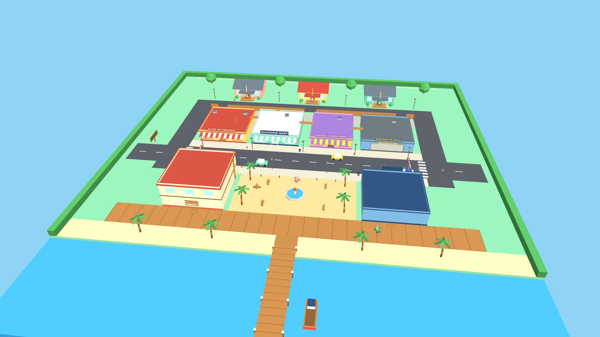

# Small Town, Big Trouble

A cooperative VR sandbox for Meta Quest 3 / 3S. You are a legless red panda in a small coastal
town. You get around by pushing against the world with your paws, and you use that to work jobs,
rob shops, run from the police, and hang out with up to three friends.

## Download

**[Download the latest APK](https://github.com/veilbrowser-git/small-town-big-trouble/releases/latest/download/SmallTownBigTrouble-dev.apk)**
for Meta Quest 3 / 3S. All builds are on the [Releases page](https://github.com/veilbrowser-git/small-town-big-trouble/releases).

To install: turn on developer mode on the headset, connect it by USB, then either drag the APK
into Meta Quest Developer Hub or SideQuest, or run `adb install -r SmallTownBigTrouble-dev.apk`.
It appears under **Unknown Sources** in the app library.

This is a development build. It passes its automated tests but has not yet been played on a
headset, so expect rough edges.

## About this repository

This repository is the Unity project. **Milestones A (movement), B (solo gameplay loop) and C
(co-op for up to four players on a local network) are implemented.** See [Docs/STATUS.md](Docs/STATUS.md) for what is built, what is verified, and what
comes next.



## Requirements

| | |
|---|---|
| Unity | 6000.6.8f1 with Android Build Support (SDK, NDK, OpenJDK) |
| Headset | Meta Quest 3 or 3S, developer mode on |
| Desktop testing | Any Mac or PC. No headset needed for the simulated input mode |

Package versions are recorded in [Docs/STATUS.md](Docs/STATUS.md#package-versions).

## First run

1. Open the folder in Unity Hub with editor 6000.6.8f1.
2. Open `Assets/SmallTown/Scenes/Menu.unity` (the front door), `Town.unity` (straight into a solo
   game) or `MovementTest.unity` (the movement gym).
3. Press Play. With no headset connected the simulated input mode starts automatically.

You start in your apartment with $20. Slap the GYM button on the wall for movement lessons; the
gym has a TOWN button to come back. MENU on the same wall leaves the game.

## Playing with friends

Up to four players on the same network (same Wi-Fi). No account or internet service is needed.

1. One player slaps **HOST** on the menu. Their address shows on the menu board and again when
   the town loads.
2. Everyone else types that address on the menu keypad and slaps **JOIN**.
3. If the host leaves, everyone is returned to the menu and told why.

How co-op works:

- **The host runs the town.** Police, shops, jobs, money and wanted levels are decided on the
  host's headset. Your own movement and anything in your hands stay on your headset, so they feel
  immediate.
- **Jobs pay everyone.** One player can take the order, another cook, another deliver; every
  player in the game gets the full payout.
- **Trouble is personal.** Only the player who robs, shoplifts or shoots is wanted. Standing next
  to a robbery is fine. Picking up the register's cash once the alarm is ringing makes you
  wanted too.
- **One holder at a time.** If two players grab the same thing, whoever's request reaches the
  host first gets it. You cannot take things out of another player's hands or satchel. Drop it
  or throw it to hand it over.
- **Your progress is yours.** Money and purchases save on your own headset and come with you
  into any game.
- Each player has a different fur colour. Friendly fire is off: shots pass through players.

Internet play through Unity's online sessions is not set up yet; see Docs/STATUS.md.

Everything generated (project settings, layers, URP assets, OpenXR configuration, prefabs, the
test scene) can be rebuilt at any time from the menu **Small Town > Setup > Run Everything**, or
headless:

```bash
./run_checks.sh setup
```

Run every automated test headless:

```bash
./run_checks.sh tests
```

Check co-op for real: build the desktop player, then launch several copies on this machine that
connect to each other and play a scripted session (delivery, robbery, escape, arrest, a grab
contest, a disconnect, the host leaving) and compare what each one saw.

```bash
./run_checks.sh mac
```

```bash
python3 Tools/coop_check.py --players 4
```

Build a development APK for Quest (output in `Builds/Android/`):

```bash
/Applications/Unity/Hub/Editor/6000.6.8f1/Unity.app/Contents/MacOS/Unity -batchmode -quit -buildTarget Android -projectPath . -executeMethod SmallTown.EditorTools.BuildScript.BuildAndroidDevelopment -logFile Logs/build-android.log
```

Install it on a connected headset with `adb install -r Builds/Android/SmallTownBigTrouble-dev.apk`
(adb ships inside the Unity Android module; it is not on the PATH of this machine).

## What there is to do

- **Work.** Cross the street to Slice of Trouble and slap ORDER. Press the listed toppings onto
  the base, slide it into the oven, put it on the boxing mat, and carry the box to the customer
  under the yellow beacon. $60, plus a $25 tip if you are quick. Lose the pizza and a fresh base
  appears; slap CANCEL to give up.
- **Shop.** Second Chance Pawn sells a pistol ($110) and a bigger satchel ($180). Slap BUY.
- **Rob.** Point the pistol at the QuickPaw Mart cashier for a moment (or fire it inside). The
  register pays out five cash bundles, the alarm goes off, and the shop stays cleaned out for a
  few minutes. Grabbing goods off the shelves and walking out is shoplifting.
- **Run.** Police only know what they can see or what gets reported. Break line of sight and
  stay hidden for 20 seconds and you are clear. The back door, the alley and the rooftops (yellow
  striped pipe behind the store) are your friends. Shooting a cop dazes them and makes everything worse.
- **Cash in.** Stolen cash in your satchel becomes yours the moment you get away. Sell stolen
  goods on the green tray at the pawn shop.
- **Get caught.** A fine, stolen goods confiscated, and you are put back outside the station.
  Your money in the bank and everything you bought are safe.

Progress saves automatically (money, purchases, stats). Wanted level and loot do not.

## How movement works

There is no thumbstick walking. Your controllers are your paws.

- **Move:** put a paw on the ground and drag it backward. Your body slides the other way. Swap
  paws to keep going. Faster drags are faster runs.
- **Jump:** shove the ground down hard with both paws and lift them away.
- **Walls:** push a wall to bounce off it. Ordinary walls are slippery; you cannot hang on them.
- **Climb:** yellow and black striped surfaces can be gripped. Squeeze the grip with a paw on or
  near the stripes and you hold on in every direction. Pull down to go up; let go mid-pull to
  fling yourself.
- **Brake:** plant a paw.
- **Duck:** crouch in real life. Your body shortens so you fit under low ceilings.
- Slapping the ground hard makes you hop. That is physics, not a bug; plant gently to walk.

Your eyes are about 0.8 m above the ground. The world is built to that scale.

## Controls (Quest Touch / Touch Plus)

| Action | Input |
|---|---|
| Move, jump, climb | Push the world with your hands |
| Grab / release / throw | Grip. Let go mid-swing to throw |
| Fire a held pistol | Trigger. It reloads itself when empty |
| Menu keypad | Slap the digits to type the host's address |
| Grip a climbable surface | Grip with an empty hand on yellow stripes |
| Store an item | Hold it inside the satchel on your left hip and release the grip |
| Take the last item out | Empty hand inside the satchel, squeeze grip |
| Snap turn | Right thumbstick left / right (45 degrees per flick) |
| Unstuck | Hold A + X for 1.2 s. Returns you to the last safe ground you stood on |
| Calibrate height and reach | Stand tall, arms relaxed at your sides, hold B + Y for 1.2 s |
| Press a world button | Slap it |

### Carrying rules

- A paw that is holding something does not push you. Move with the other paw, or bag the item.
- Held and loose items are never surfaces you can push off, so nobody flies by pushing on a
  carried object.
- Light items follow one hand; gripping with the other hand swaps hands.
- Heavy items (the blue trunk) stay under gravity. One hand can drag or tip them; two hands lift.
  The two hands can belong to two different players.

## Simulated input (development only)

Used automatically in the editor and in development builds when no headset is present. The keys
play scripted arm strokes; the real contact solver turns those into motion, so collisions,
friction and momentum behave as they do in the headset. It is a development aid and is not a
substitute for headset testing.

| Key | Action |
|---|---|
| Right mouse (hold) or Tab (toggle) + mouse | Look |
| W A S D | Stride forward / left / back / right |
| Space | Two-handed jump push |
| Left Ctrl | Crouch |
| Q / E | Snap turn |
| G / H | Left / right grip |
| T / Y or left mouse | Left / right trigger |
| F (hold) | Raise the right hand and point it where you look (aim a held pistol) |
| 1 / 2 | Select left / right hand for manual nudging, 3 resets |
| I K J L O . | Nudge the selected hand forward, back, left, right, up, down |
| U (hold) | Unstuck |
| C (hold) | Calibrate |
| R | Respawn |

## Art pipeline (Blender)

The town and the character are generated in Blender from Python, headlessly, and exported as FBX.
Nothing is hand-edited, so everything can be regenerated:

```bash
/Applications/Blender.app/Contents/MacOS/Blender -b --factory-startup -P Tools/blender/build_town.py
```

```bash
/Applications/Blender.app/Contents/MacOS/Blender -b --factory-startup -P Tools/blender/build_character.py
```

```bash
/Applications/Blender.app/Contents/MacOS/Blender -b --factory-startup -P Tools/blender/build_palettes.py
```

Then rebuild the Unity content with `./run_checks.sh setup`.

- Scripts author everything in Unity coordinates and metres (`Tools/blender/lowpoly.py` converts).
- Colour comes from one small palette atlas, so the whole town is one material.
  Townsfolk and police are the same panda meshes with a recoloured atlas.
- `build_town.py` also writes `Town.layout.json`: colliders, climbable surfaces, zones, sign text
  and named markers. Unity builds collision and places every gameplay station from that file, so
  moving a counter in Blender moves the job with it.
- To edit by hand instead, open the FBX in Blender, but re-running the script will overwrite it.

## Tuning

Prices, payouts, timers, police numbers and fines are on
`Assets/SmallTown/Settings/GameBalance.asset`.

All movement values are on `Assets/SmallTown/Settings/HandLocomotionSettings.asset`: hand
radius, arm reach, ground and wall friction, propulsion and jump multipliers, launch and speed
limits, gravity, ground and air momentum decay, body size, step height, slope limit, snap turn
angle. Changes apply the next time you press Play.

## Project layout

```
Assets/SmallTown/
  Runtime/
    Locomotion/   Hand contact solver, body collision solver, rig coordinator, calibration
    RigInput/     XR, simulated and scripted input providers
    Interaction/  Grabbing, throwing, storage bag, world buttons, contact feedback
    Avatar/       Red panda torso and arm posing
    UI/           Tutorial, wrist device, toasts, screen fade
    Economy/      Wallet, save files, balance data
    Jobs/         Job framework, pizza delivery
    Crime/        Robbery, pawn shop, wanted level, police, arrest
    Items/        Loot, pistol, owned equipment
    Npc/          Townsfolk bodies and behaviour
    Net/          Launcher, networked player, shared items and NPCs, session relay, test bot
    Core/         Session, per-player state, layers, zones, feedback sounds
  Editor/         Automated project setup, prefab and scene builders, build script
  Tests/          Edit mode and play mode tests
  Settings/ Prefabs/ Scenes/ Art/   Generated by the setup menu
Tools/blender/    Python generators for the town, the character and palettes
Tools/coop_check.py  Multi-process co-op verification
Docs/STATUS.md    Milestone status, verification record, known issues, next steps
run_checks.sh     Headless setup and test runner
```
